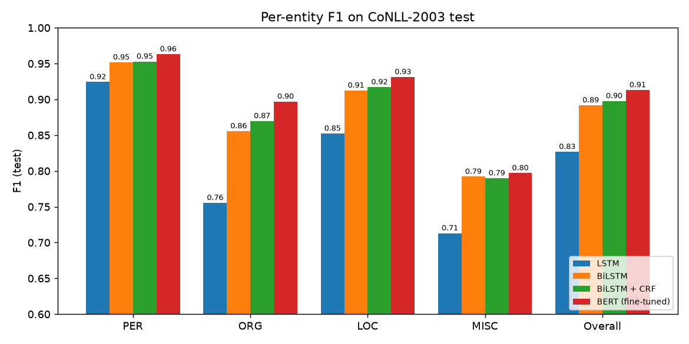
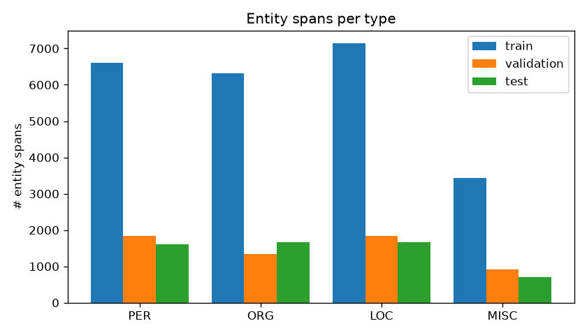
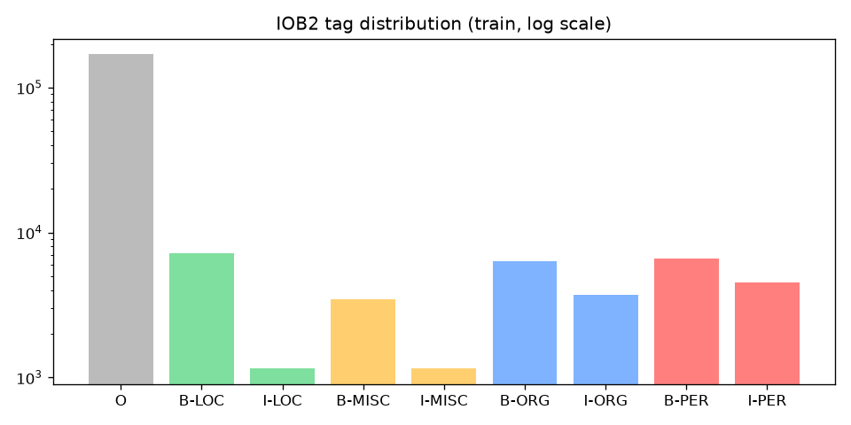
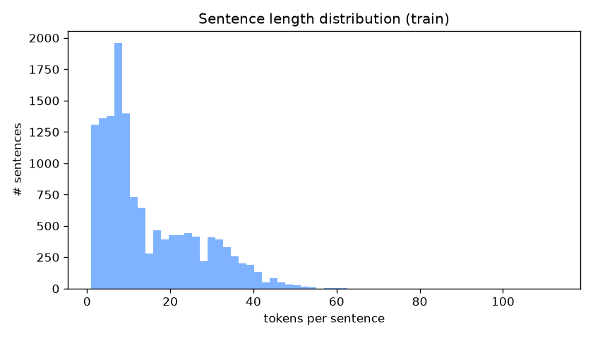
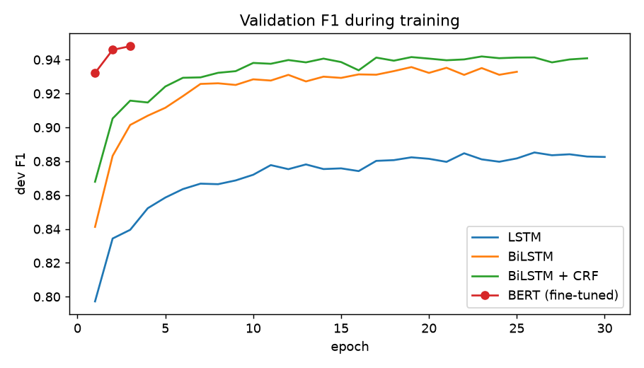
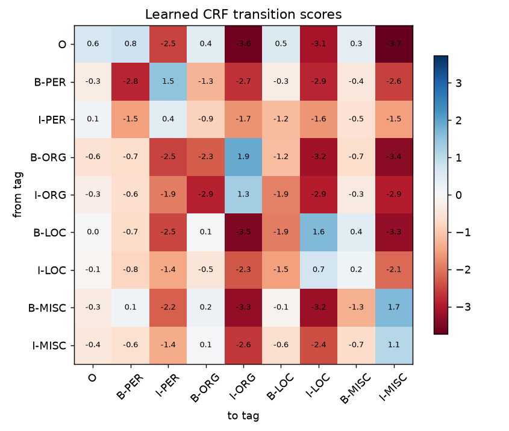
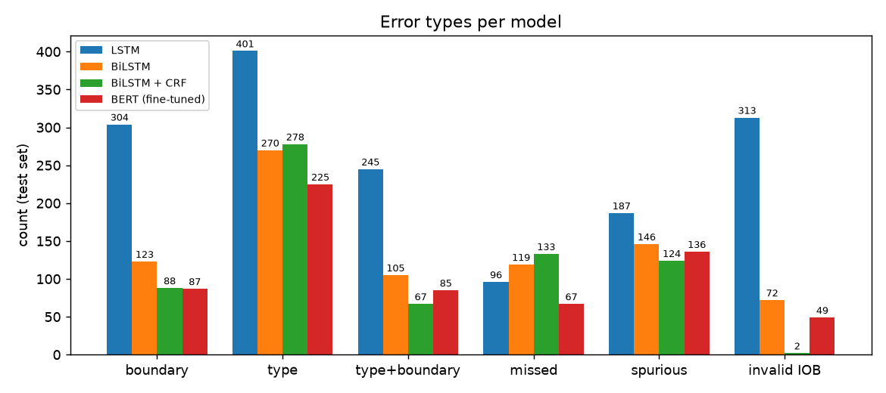
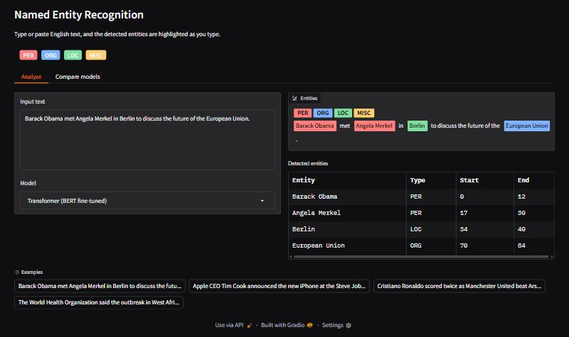
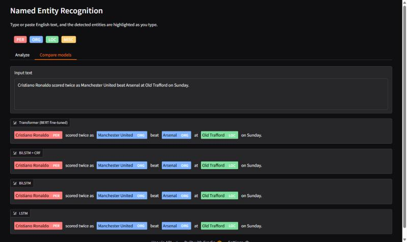

# Named Entity Recognition System

An end-to-end sequence-labeling pipeline that finds and classifies named entities: **people (PER), organizations (ORG), locations (LOC) and miscellaneous (MISC)**. It is trained on **CoNLL-2003** and compares four architectures:

| # | Architecture | Implementation |
|---|---|---|
| 1 | **LSTM** + softmax | from scratch (PyTorch) |
| 2 | **BiLSTM** + softmax | from scratch (PyTorch) |
| 3 | **BiLSTM + CRF** | from scratch (PyTorch, CRF with forward algorithm + Viterbi written by hand) |
| 4 | **BERT** (`bert-base-cased`) fine-tuned | HuggingFace `AutoTokenizer`, `AutoModelForTokenClassification`, `Trainer` |

All models are evaluated with **seqeval** (entity-level precision, recall and F1 per entity type). The best model is served in a **Gradio** web app that highlights entities in real time as you type.



---

## Results (CoNLL-2003 test set)

Entity-level **seqeval** scores (an entity counts as correct only if its span *and* type match exactly):

| Model | Precision | Recall | **F1** | PER F1 | ORG F1 | LOC F1 | MISC F1 | Dev F1 |
|---|---|---|---|---|---|---|---|---|
| LSTM | 0.8079 | 0.8465 | **0.8267** | 0.9243 | 0.7555 | 0.8522 | 0.7130 | 0.8852 |
| BiLSTM | 0.8872 | 0.8964 | **0.8918** | 0.9517 | 0.8557 | 0.9124 | 0.7920 | 0.9357 |
| BiLSTM + CRF | 0.9007 | 0.8947 | **0.8977** | 0.9529 | 0.8698 | 0.9170 | 0.7898 | 0.9419 |
| BERT-base-cased (fine-tuned) | 0.9069 | 0.9191 | **0.9129** | 0.9631 | 0.8969 | 0.9312 | 0.7970 | 0.9480 |

Per-entity precision and recall for every model are in [`results/comparison.md`](results/comparison.md), and the raw seqeval reports are in `results/*_metrics.json`.

**Takeaways**
* **Bidirectionality gives the largest jump** (+6.5 F1). A left-to-right LSTM must decide on "Manchester" before it reads "United". ORG gains the most (+10 F1), because many organizations are only recognisable from the words that follow.
* **The CRF adds +0.6 F1 overall**, mostly through **precision** (0.887 → 0.901) and the ORG class (+1.4 F1), the class with the most multi-token names. The [section below](#where-does-the-crf-help-boundary-detection) explains why.
* **Fine-tuned BERT is best on every entity type** (91.3 F1). Pre-training on billions of words gives it world knowledge and contextual sub-word representations that GloVe + char-CNN cannot match. It cuts *missed* entities in half (67 vs 133).
* **MISC is the hardest class** for every model (~0.79–0.80). It is a heterogeneous mix of nationalities, events and titles, and it has the fewest training examples.

---

## Pipeline

### 1. Data and exploration (`ner/data.py`, `ner/eda.py`)
* CoNLL-2003 (Reuters newswire, the same data as the HuggingFace `conll2003` dataset). If the raw files are missing from `data/conll2003/`, they are downloaded automatically.
* 14,041 / 3,250 / 3,453 sentences (train / validation / test), 23.5k entity spans in train.
* `python -m ner.eda` writes statistics and plots to `results/eda/`:

| Entity distribution | Tag distribution (log) | Sentence lengths |
|---|---|---|
|  |  |  |

* **12.2 % of test tokens never occur in the training set.** That is the OOV problem the character features below solve.

### 2. IOB tagging scheme
Labels use **IOB2**: `B-X` begins an entity of type X, `I-X` continues it, and `O` is outside any entity.
```
EU      rejects German  call  to  boycott British lamb .
B-ORG   O       B-MISC  O     O   O       B-MISC  O    O
Peter Blackburn
B-PER I-PER
```
`to_iob2()` converts the original IOB1 encoding (where `B-` is used only between two adjacent entities of the same type) into IOB2, `get_spans()` turns tag sequences into entity spans, and `invalid_transitions()` counts illegal sequences such as `O → I-PER`.

### 3. Token representation and OOV handling
Every word in the RNN models is the concatenation of:
* **GloVe** `glove-wiki-gigaword-100` pre-trained word vectors, fine-tuned during training. The vocabulary is the training words plus the 50k most frequent GloVe words, so free text in the app also gets pre-trained vectors.
* A **character-level CNN** (char embeddings → Conv1d → max-pool, after Ma & Hovy 2016). It builds a vector for *any* word from its spelling, which captures capitalization, suffixes such as *-burg* or *-ville*, and digits.
* A small **casing embedding** (all-caps, init-cap, numeric, …), because GloVe vectors are lower-cased.
* **Word dropout** (5 % of words replaced by `<unk>` while training), which teaches the network to rely on characters when a word is unknown.

For BERT, OOV is handled by **WordPiece sub-word tokenization**. The labels are realigned to sub-words: only the first piece of each word keeps its label, and the other pieces plus `[CLS]`/`[SEP]` get `-100`, so they are ignored by the loss and the metric (`tokenize_and_align` in `ner/train_transformer.py`).

### 4. Models (`ner/models.py`)
```
words ─► [GloVe ; CharCNN ; casing] ─► dropout ─► (Bi)LSTM ─► dropout ─► Linear ─► softmax  (LSTM / BiLSTM)
                                                                              └──► CRF       (BiLSTM + CRF)
```
* The **LSTM** reads left-to-right only, so when tagging a word it has not seen the words that follow it.
* The **BiLSTM** adds a backward LSTM, so every tag sees the whole sentence. Each tag is still chosen *independently* by a softmax.
* The **BiLSTM + CRF** replaces the softmax with a linear-chain **CRF**. It learns a 9×9 transition matrix, trains on the sequence log-likelihood (forward algorithm), and decodes the single best tag *sequence* with Viterbi. `tests/test_core.py` checks the CRF against brute-force enumeration of all paths.
* The unidirectional LSTM gets the same total hidden size (400) as the BiLSTMs (2×200), so the comparison is fair.

### 5. Training
* RNNs: Adam (lr 1e-3), batch 32, gradient clipping 5, dropout 0.5, LR halved on dev-F1 plateau, early stopping (patience 6), and the best dev-F1 checkpoint is kept.
* BERT: `bert-base-cased`, 3 epochs, lr 3e-5, warm-up 10 %, fp16, best epoch by dev F1, all through HuggingFace `Trainer`.



### 6. Evaluation (`ner/compare.py`)
seqeval entity-level metrics: an entity counts as correct only if **both its boundaries and its type** are exactly right. On top of that, `compare.py` breaks every error down into *boundary*, *type*, *type + boundary*, *missed* and *spurious* errors, and counts invalid IOB transitions.

---

## Where does the CRF help? Boundary detection

A softmax tagger (LSTM, BiLSTM and even BERT here) picks each tag **independently**. Nothing stops it from producing sequences that cannot be decoded into clean spans:

```
REAL   MADRID  V  BARCELONA          gold:          [REAL MADRID]ORG  [BARCELONA]ORG
B-ORG  B-ORG   O  B-ORG              BiLSTM:        [REAL]ORG [MADRID]ORG  ✗  (span split in two)
B-ORG  I-ORG   O  B-ORG              BiLSTM + CRF:  [REAL MADRID]ORG       ✓
```

The CRF scores the **whole tag sequence**: each tag's emission score plus a learned **transition score** between consecutive tags. Viterbi decoding then finds the globally best sequence. The learned transition matrix rediscovered the IOB2 grammar from data alone, with no hard-coded rules:



* `O → I-X` is strongly penalised (−2.5 to −3.7), so an entity cannot *start* with `I-`.
* `B-X → I-Y` with X ≠ Y is penalised (for example `B-PER → I-ORG` −2.7), so an entity cannot change type halfway through.
* `B-X → I-X` and `I-X → I-X` are rewarded (+0.4 to +1.9), so multi-word names stay in one piece.
* `B-X → B-X` is penalised (`B-PER → B-PER` −2.8). Two adjacent same-type entities are rare, so the CRF prefers to *join* tokens like "Sheffield Wednesday" rather than split them.

**Measured effect on the test set** (`python -m ner.compare`):

| Model | Correct spans | Boundary errors | Type + boundary errors | Spurious | **Invalid IOB transitions** |
|---|---|---|---|---|---|
| LSTM | 4781 | 304 | 245 | 187 | 313 |
| BiLSTM | 5063 | 123 | 105 | 146 | 72 |
| **BiLSTM + CRF** | 5053 | **88** (−28 %) | **67** (−36 %) | **124** | **2** |
| BERT (softmax head) | 5191 | 87 | 85 | 136 | 49 |



* Invalid IOB transitions drop from **72 to 2**. The BiLSTM + CRF output is almost always a well-formed span sequence.
* **Boundary errors** (right type, wrong span) fall by 28 %, and errors that are wrong in both type and boundary fall by 36 %. The gain is largest on multi-token names: *Sheffield Wednesday*, *NY JETS*, *Basketball Association*, *Nader Jokhadar*.
* The trade-off is that the CRF is a little more conservative: slightly more missed entities (133 vs 119) and a lower MISC recall. That is why its F1 gain (+0.6) is smaller than its precision gain (+1.4).
* Even BERT, without a CRF, emits 49 invalid transitions. Adding a CRF head on top of a transformer is a common next step.
* 21 test sentences are tagged perfectly *only* thanks to the CRF. They are rendered with color-coded spans in [`results/crf_examples.html`](results/crf_examples.html).

---

## Interactive app (Gradio)

```bash
python app.py
```
Open http://127.0.0.1:7860, type or paste text, and the entities are highlighted **as you type** (`Textbox.change` events) in color-coded spans (PER red, ORG blue, LOC green, MISC yellow), with a table of detected entities and their character offsets. The fine-tuned BERT model is the default. You can switch model in the dropdown, and the **Compare models** tab shows all four models side by side on the same text.

| Analyze (real-time highlighting) | Compare models |
|---|---|
|  |  |

---

## Reproduce

```bash
python -m venv .venv && .venv\Scripts\activate          # Windows  (source .venv/bin/activate on Linux/macOS)
pip install torch --index-url https://download.pytorch.org/whl/cu121   # pick the build for your GPU / CPU
pip install -r requirements.txt

python -m pytest tests                       # IOB utilities + CRF correctness
python -m ner.eda                            # dataset exploration -> results/eda/
python -m ner.train_rnn --arch lstm          # ~6 min on a GTX 1660 Super
python -m ner.train_rnn --arch bilstm        # ~6 min
python -m ner.train_rnn --arch bilstm_crf    # ~20 min
python -m ner.train_transformer --model bert-base-cased   # ~40 min on a GTX 1660 Super (or distilbert-base-cased)
python -m ner.compare                        # tables, plots, CRF analysis -> results/
python app.py                                # web app
```
GloVe vectors (128 MB) download automatically to `data/embeddings/`. The trained RNN checkpoints are included in `models/`. The fine-tuned BERT model (~430 MB) is too large for the repository, so it is created by `train_transformer` (the app simply lists the models that exist).

## Project structure
```
ner/
  __init__.py            labels, paths, entity colors
  data.py                CoNLL reader, IOB2 utilities, vocab, char/casing features, batching
  embeddings.py          GloVe download + embedding matrix
  models.py              CharCNN, CRF (from scratch), LSTM / BiLSTM / BiLSTM-CRF tagger
  train_rnn.py           training + seqeval evaluation for the RNN models
  train_transformer.py   HuggingFace fine-tuning (AutoTokenizer, AutoModelForTokenClassification, Trainer)
  predict.py             free-text inference for every model
  eda.py                 exploratory data analysis
  compare.py             comparison tables, plots, boundary/CRF error analysis
app.py                   Gradio app
tests/test_core.py       unit tests (IOB, spans, CRF vs brute force)
results/                 metrics JSON, predictions, plots, comparison.md, crf_examples.html
models/                  trained RNN checkpoints
```
